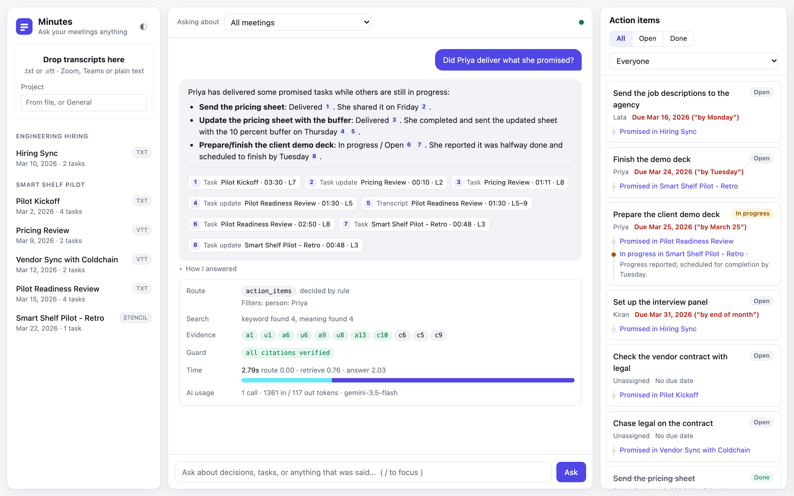
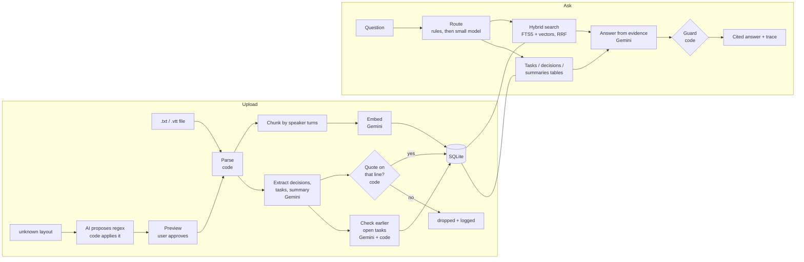
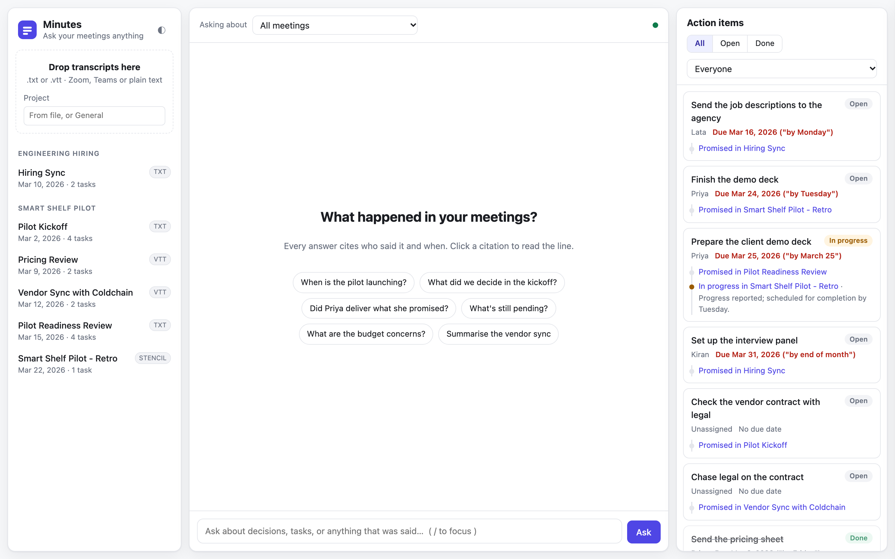
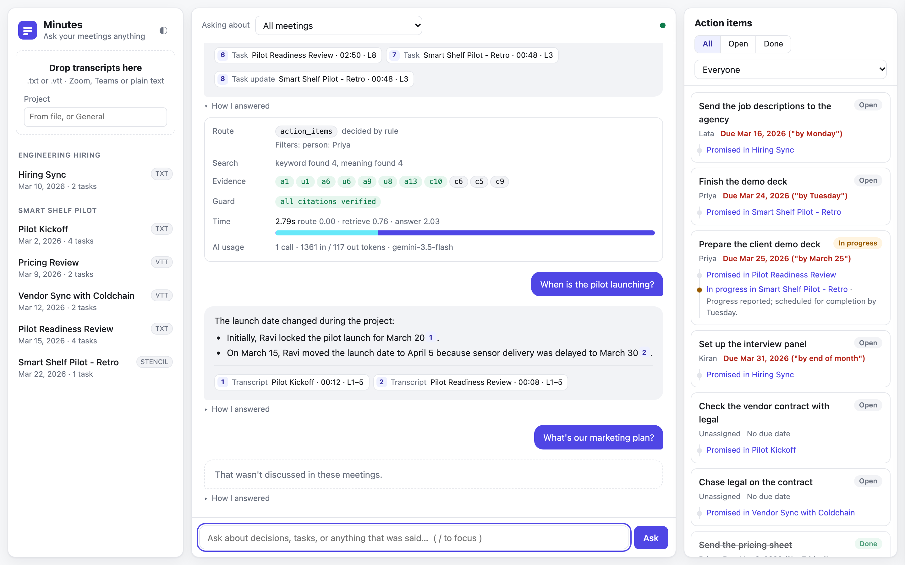
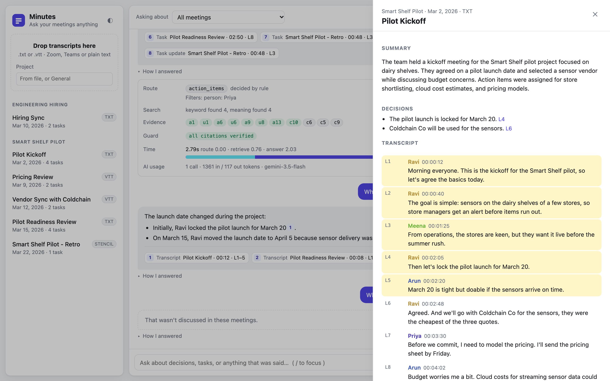
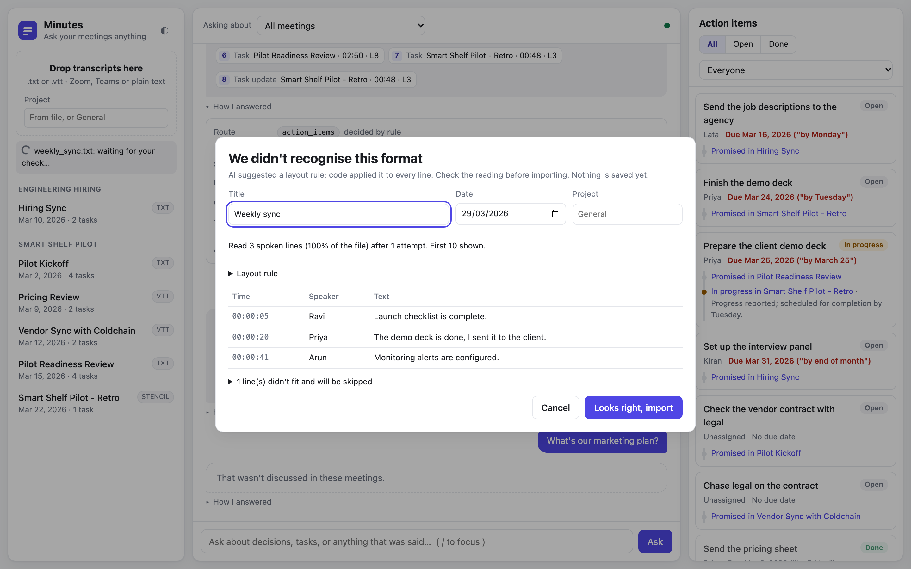
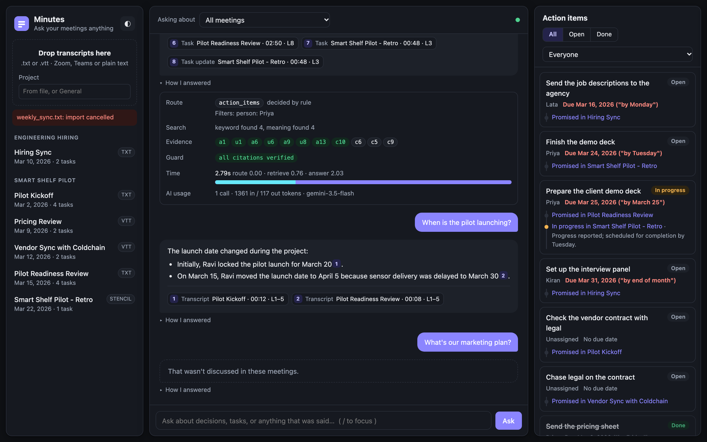

# Minutes: meeting intelligence

Upload meeting transcripts, then ask what was decided, who owes what, and whether
they delivered. Every answer cites who said it and when, and a click opens the line.



## Quick start

Needs Docker and a free Gemini API key from [Google AI Studio](https://aistudio.google.com) (Get API key).

```bash
cp .env.example .env          # paste your key after GEMINI_API_KEY=
docker compose up --build     # then open http://localhost:8000
```

Click **Load sample meetings** to import six synthetic meetings, then try a starter question.

Without Docker (Python 3.13 and [uv](https://docs.astral.sh/uv/)):

```bash
uv sync
uv run uvicorn app.main:app --reload
```

Tests (no API key needed) and evals (uses your key):

```bash
uv run pytest -q
uv run python -m evals.run_evals            # writes evals/results.md
uv run python -m evals.run_evals --sweep    # chunk size x top-k retrieval table
```

## What it does

- **Upload** `.txt` or Zoom / Teams `.vtt` transcripts. An unknown layout gets an
  AI-suggested parsing rule and a preview you must approve before anything is saved.
- **Ask** anything about the meetings, scoped to all meetings, one project or one meeting.
- **Decisions, action items and summaries** are extracted once at upload. Later meetings
  mark earlier tasks done, in progress or cancelled, each change linked to the line that proves it.
- **"How I answered"** under each answer shows the route, evidence, guard result, timings and tokens.

## Architecture



| Module | Job |
|---|---|
| `app/parsing.py` | `.txt` / `.vtt` to speaker turns |
| `app/stencil.py` | Unknown layouts: AI proposes a regex, code applies it with a timeout |
| `app/chunking.py` | Speaker-turn windows with one turn of overlap |
| `app/ingest.py` | Store meeting, turns, chunks, vectors; flag injection-like lines |
| `app/extract.py` | Summary, decisions, tasks, due dates, follow-ups; every item quote-checked |
| `app/search.py` | Keyword (FTS5/BM25) + vector search merged with Reciprocal Rank Fusion |
| `app/ask.py` | Route, gather evidence, answer, trace |
| `app/answer.py` | Answer prompt and the citation guard |
| `app/llm.py` | The only file that talks to Gemini: retries, fallback model, token counts |
| `app/main.py` | HTTP API, rate limits |
| `app/static/` | UI: plain HTML, CSS and JS |

## Evals

<!-- Paste the summary table from evals/results.md and the sweep table, then say in
     your own words what they tell you and what failed. -->

## Productionising and scaling on a hyperscaler

<!-- Your words. -->

## RAG / LLM approach and decisions

<!-- Your words: LLM, embedding model, vector store, orchestration framework,
     chunking, retrieval, prompt and context management, guardrails, quality,
     observability. For each: what you considered, what you chose, why. -->

## Key technical decisions

<!-- Your words. -->

## Engineering standards

<!-- Your words: followed, and skipped on purpose. -->

## How I used AI tools

<!-- Your words. CLAUDE.md holds the rules the assistant had to follow. -->

## What I'd do with more time

<!-- Your words. -->

## Known limitations

<!-- Your words. -->

## Screenshots

| | |
|---|---|
|  Starting point |  Cited answer + "How I answered" |
|  Changed decision, and a question nobody discussed |  A citation opens the transcript at the line |
|  Unknown format: preview before import |  Dark mode |

The sample transcripts in `data/samples/` are synthetic and were written for this project.
