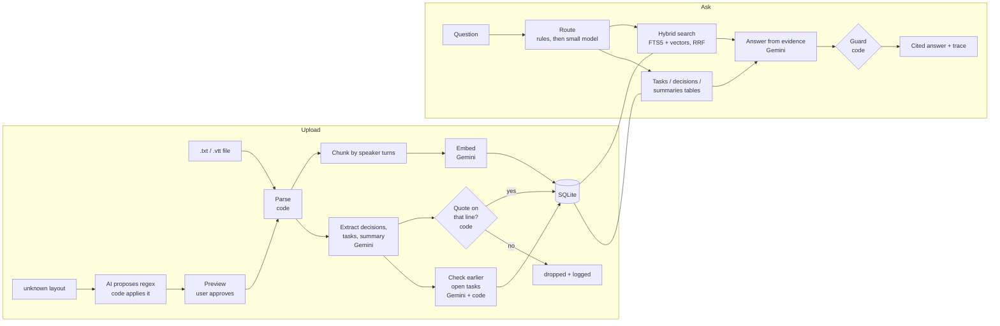
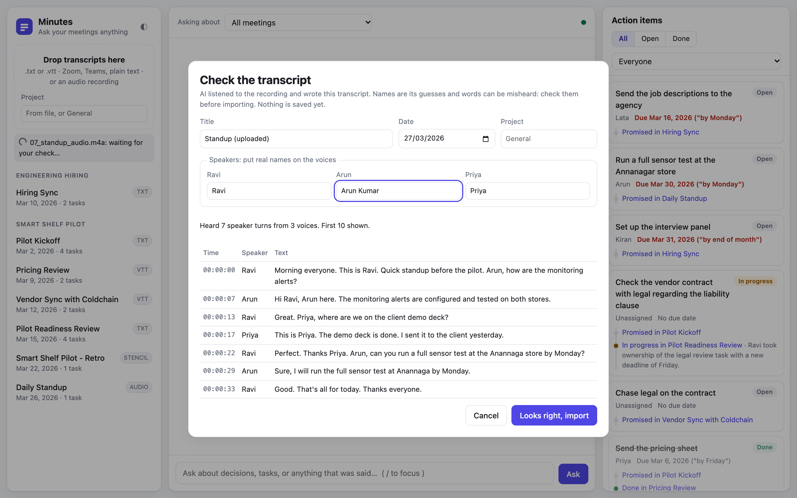

# Minutes: meeting intelligence

Upload meeting transcripts, then ask what was decided, who owes what, and whether
they delivered. Every answer cites who said it and when, and a click opens the line.


**Demo video (2 min, silent with captions):** [docs/demo.webm](docs/demo.webm)

## Quick start

Needs Docker and a free Gemini API key from [Google AI Studio](https://aistudio.google.com) (Get API key).

```bash
cp .env.example .env          # paste your key after GEMINI_API_KEY=
docker compose up --build     # then open http://localhost:8000
```

Click **Load sample meetings** to import six synthetic meetings, then try a starter question.

Without Docker (Python 3.13 and [uv](https://docs.astral.sh/uv/)):

```bash
uv sync
uv run uvicorn app.main:app --reload
```

Tests (no API key needed) and evals (uses your key):

```bash
uv run pytest -q
uv run python -m evals.run_evals            # writes evals/results.md
uv run python -m evals.run_evals --sweep    # chunk size x top-k retrieval table
```

## What it does

- **Upload** `.txt` or Zoom / Teams `.vtt` transcripts. An unknown layout gets an
  AI-suggested parsing rule and a preview you must approve before anything is saved.
- **Record instead of typing:** upload a meeting recording (.mp3 .m4a .wav .ogg .webm, up to 20 MB).
  Gemini writes the transcript; you check the words and name the speakers before it is imported.
- **Ask** anything about the meetings, scoped to all meetings, one project or one meeting.
- **Decisions, action items and summaries** are extracted once at upload. Later meetings
  mark earlier tasks done, in progress or cancelled, each change linked to the line that proves it.
- **"How I answered"** under each answer shows the route, evidence, guard result, timings and tokens.

## Architecture



| Module | Job |
|---|---|
| `app/parsing.py` | `.txt` / `.vtt` to speaker turns |
| `app/stencil.py` | Unknown layouts: AI proposes a regex, code applies it with a timeout |
| `app/audio.py` | Recordings: Gemini transcribes into the `.txt` format, speakers renamed in the preview |
| `app/chunking.py` | Speaker-turn windows with one turn of overlap |
| `app/ingest.py` | Store meeting, turns, chunks, vectors; flag injection-like lines |
| `app/extract.py` | Summary, decisions, tasks, due dates, follow-ups; every item quote-checked |
| `app/search.py` | Keyword (FTS5/BM25) + vector search merged with Reciprocal Rank Fusion |
| `app/ask.py` | Route, gather evidence, answer, trace |
| `app/answer.py` | Answer prompt and the citation guard |
| `app/llm.py` | The only file that talks to Gemini: retries, fallback model, token counts |
| `app/main.py` | HTTP API, rate limits |
| `app/static/` | UI: plain HTML, CSS and JS |

## Evals

I tested using evals with different facts, tasks, decisions, not discussed questions and tricks, around 24 questions, and ran it on the real app. First run was 22 out of 24. Then I checked where it went wrong. One was my test was too strict, the answer was correct but the test wanted proof from one meeting only, so I changed the test. But other ones were real bugs in my code, like the word "shelf" in the question was matching a meeting title and searching only that meeting. After fixing those it came 24 out of 24, I ran it 2 times and both full. But honestly I wrote the questions and the meetings both, its clean test data, so with real meetings the score will be lower.

Latest run (full table in [evals/results.md](evals/results.md), chunk size sweep in [evals/sweep.md](evals/sweep.md)):

| Group | Passed |
|---|---|
| Facts | 6/6 |
| Why | 1/1 |
| Tasks & status | 5/5 |
| Decisions | 2/2 |
| Summary | 1/1 |
| Across meetings | 2/2 |
| Not discussed | 3/3 |
| Prompt injection | 2/2 |
| Project scope | 2/2 |
| **All answers** | **24/24** |
| Right meeting in the evidence sent | 10/10 |

## Productionising and scaling on a hyperscaler

Database I will use Postgres with pgvector. To handle users for authentication and login I will use company login (SSO) through Google or Microsoft Entra ID. Run it on a cloud, GCP or Azure. If something is going to take more than 30s I will move it from the web request to a background process, mostly uploads and extraction. For secrets I will use a secret manager. For AI models we will use them directly through Vertex in GCP or Foundry in Azure, so that there is a data policy which we can speak about with the client. For monitoring the AI part I will keep a dashboard or OpenTelemetry, like that, and add something for security if needed.

Also some more things:
- each company should see only its own data, so every table will have an org id and client A cant see client B meetings
- original files i will keep in cloud storage like GCS or S3 or Azure blob, not inside the db
- right now some small things like rate limits and upload previews are in app memory, if we run more than one server that has to move to Redis
- evals should run automatically before every release and if score drops we block it
- track AI tokens per client and keep limits so one client cant make a huge bill
- backups for the db

## RAG / LLM approach and decisions

### Chunking

We didnt use general fixed chunking because its meeting notes, if we cut based on fixed characters it will cut somewhere in between. So what we did is we cut using turns, around 5 turns per chunk with one overlap. I checked using 3, 5 and 8 turns but all scored full because we dont have real data and this is all test data.

### Search

Sometimes exact word search will match but sometimes it will be different meaning. For ex if you see some unit like SKU-42 or a name Priya it will need exact word match, whereas "money worries" should be able to find "cloud cost could go over". So combining these two will work, we merged them with RRF.

### Model

Actually the reality of Gemini is Google AI Studio gives free credits. I am a big fan of Claude models, if anything complex is there I would use Claude only, for deep reasoning or tough ones. Since this is a normal meeting call parser I used Gemini because the cost is less. Flash is used for answers because its the bigger model and thinks better, whereas the Lite model is cheap and quickly gives answers, mostly used for simple tasks like routing.

### Database

I have used pgvector before because Postgres is my primary DB. Here I used SQLite to keep it one file. In prod, based on volume and necessity, I will decide between Postgres with pgvector or other libraries.

### Guardrails

To protect the system from attackers or corrupted data or files we use some protection layers. First one is system rules will be separate, and the meeting files will be enclosed in a tag, so the AI knows that is just meeting notes and not a system prompt. If the meeting line contains that end tag `</material>` we will remove that. And here AI has no power, like no action based commands. We have fixed output structure like JSON, anything else is rejected. Code checks everything, quotes must exist in the file, citations must be chunks actually sent, like that. Suspicious lines are flagged. And in our hidden rules we have a secret word, so if AI gets tricked and returns it, if we see that secret word we block that answer.

### Observability

We will have traces for each step, whats happening, chunks, relevant chunks, how many were found, which one the AI used, whether the guard removed anything, time consumption, all will be tracked. Its saved in the traces table and also shown under each answer as "How I answered". While going to production we can see it as a dashboard or use OpenTelemetry, something like that.

## Key technical decisions

Main rule i followed is AI suggests and code checks.

So what we did first user uploads the file txt or vtt. We already know the pattern how zoom, teams and normal txt will be, so based on that we parse with code and get the meeting lines, no AI needed there.

But we dont know unknown patterns so for that we get suggestion pattern from AI and code will execute that pattern on every line. When making that pattern HIL is important so user sees a preview and then only imports.

In extraction of tasks AI returns the quote also and code checks it with the transcript line using difflib library, atleast 90% match. If not matching we drop it.

For answers AI returns which chunks it used like c1 c2, and code checks those are the chunks we sent so it will know whether thats correct or not.

Agent is not needed because its a simple workflow, we know the steps because it has defined steps. Agent is needed only when we dont know the next step, in that case only. Langchain is also not needed because we are not connecting many AI llms and we dont need any templates since its a basic flow.

If we only do it when someone asks, it can only give answers. But if we pull out tasks and decisions when uploading, we can track whether that task is done in the next meetings. No need of someone sitting and tracking separately.

## Engineering standards

I wrote tests for every step (91 tests, they run without the API key) and had a set of evals, so each time based on this I can push. I put the API key safely in .env. All are separately written files, so if I need to change from Gemini to Claude its one file change. I skipped login and users, CI pipeline, DB migrations, background jobs, frontend tests, like that.

## How I used AI tools

I used Claude Code for planning, coding, testing and debugging, and used Codex GPT models to test that code. I had a CLAUDE.md rules file, based on that only I gave instructions to Claude and tested whether it followed my rules.

Do planning along with AI. Dont completely tell the problem to AI and ask it to plan, instead sit and break it into steps, see what the problem is and how to address it. While planning, plan each and every step along with AI, and once the plan is locked AI can code easily. After that test whether it has done it based on the plan.

The rules are in [CLAUDE.md](CLAUDE.md) and the locked plan in [docs/PLAN.md](docs/PLAN.md).

## What I'd do with more time

If i had more time first i would add an agent for multi step questions, like "why did the launch slip and whose delays caused it", because there the next step is not known, so that is the place agent is actually needed. Right now code only checks the citation is real, it doesnt check each sentence really matches what that line says, so i would add that check also. Duplicate tasks should be merged, like the two legal tasks which are same work raised in two meetings, and same person with different names like Priya and Priya S should be treated as one person. When we click a citation whole chunk gets highlighted, i would highlight the exact line. I would support more formats like Otter and Google Meet exports. And most important i would make a bigger eval set with real messy meetings, because now its all clean test data written by me.

## Voice to transcript (bonus)

For audio, user uploads a recording like mp3 or m4a, it goes to Gemini and Gemini writes the transcript in our same format like `[00:01:10] Name: text`, then our normal parser reads it. Since here AI is the one writing the text, user checks the preview and renames speakers like Speaker 1 to Priya before import, then only its saved and works like any other meeting.

## Known limitations

Voice feature sometimes mishears names and places, like "Anna Nagar" came as "Annanagar" one time and "Anannaga" another time, so keyword search can miss them. Speaker names in audio are guesses from context, thats why user has to check in preview. Same audio uploaded twice is not caught as duplicate because transcript comes slightly different each time. AI can mix up similar tasks, once it linked "updated pricing sheet" to the original "pricing sheet" task, status was still correct but the proof was wrong one. Upload is slow, around 30 seconds for 6 meetings because user waits while AI works. Free Gemini tier is sometimes slow or busy, we retry but it can still delay. And short sentences without citation like "Yes" or "Here are the tasks" are allowed, its a simple rule not a perfect one.

## Screenshots

| | |
|---|---|
|  Starting point |  Cited answer + "How I answered" |
|  Changed decision, and a question nobody discussed |  A citation opens the transcript at the line |
|  Unknown format: preview before import |  Recording: check the words, name the speakers |
|  Dark mode | |

The sample transcripts in `data/samples/` are synthetic and were written for this project.
